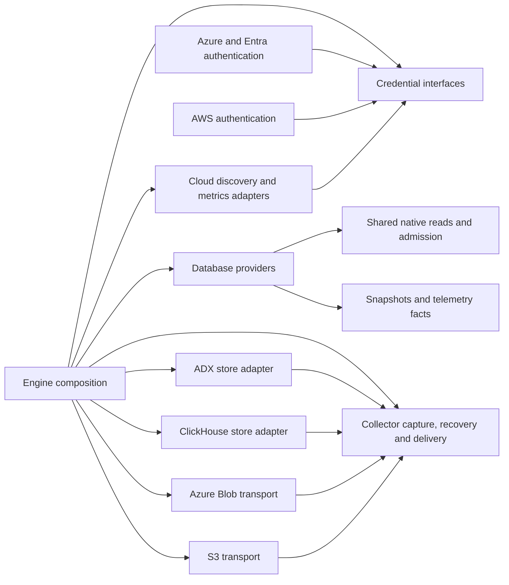

# How Culprit is built

Culprit turns a database's own statistics into findings a person can act on. This page is the map: the stages data
goes through, where each lives, the rules every stage follows so a finding is never a false flag, and how to add a
provider, a source, a check or a rule. `docs/DESIGN.md` is the source of truth for what the product does and says; this
page is how the code does it.

```
 database ──▶ sources ──▶ snapshot ──▶ prepare ──▶ detect ──▶ refine ──▶ rank ──▶ report ──▶ app · CLI · MCP
             (provider)   (model)      (fix the    (checks:   (rules      (impact,  (findings,  dashboard, digest,
                                        picture)    one issue  over all    then      locked      index advice, brief
                                                    each)      findings)   severity) checks)
```

Everything left of *snapshot* talks to a database; nothing right of it does. A snapshot is a plain, serializable
picture of one database at one time, so every stage after it is a pure function: the app, the CLI and the MCP server
produce the same findings, a saved scan can be analyzed again offline (`culprit analyze`), and every rule is testable
with a fixture.

## The crates

| Crate | What it owns |
|---|---|
| `culprit-read` | Provider-independent response budgets, bounded row delivery, native admission fences and snapshot/frame paging. No SQL, connections, scheduling or destination state. |
| `culprit-core` | The model (`Snapshot`, `Plan`, `Finding`), the `Check` and `Provider` traits, plan insights, `Coverage`. No I/O. |
| `culprit-mssql`, `culprit-postgres`, `culprit-yugabyte`, `culprit-mysql`, `culprit-sqlite` | Providers: the sources for one engine, and explain, live sessions, deadlocks where supported. YugabyteDB owns DocDB measurements and shares PostgreSQL wire transport, not its heap collectors. SQLite reads a file, read-only: schema, statistics, settings and plans, no sessions or waits. |
| `culprit-querylog` | Logs an application's framework already writes (Rails, Django, EF Core, Phoenix/Ecto, JSON lines), read into a `Workload` for an engine that keeps no statement history: one module per format behind a `Format` trait, statements grouped by `culprit_core::fingerprint`. The log's own timestamps are its period (`Workload.log`), never "the last N hours". |
| `culprit-checks` | The analysis pipeline, every check, the refine rules, and the views built on a report. |
| `culprit-engine` | Connections and secret storage, adapter composition, scans, saved reports and history. |
| `culprit-collector` | Source-independent capture, local outbox, fleet scheduling, recovery/delivery contracts, analytical preparation and service lifecycles. |
| `culprit-cloud` | Pluggable discovery and metrics with injected authentication, commands, HTTP and cache storage. |
| `culprit-cli`, `culprit-mcp`, `app/` | Surfaces: the same report, worded for a terminal, a coding agent, a window. |

### Workspace services

`Workspace` keeps the public API and owns its configured stores, checks, authentication and provider factories.
It constructs borrowed services from those dependencies for each operation, so replacing a secret store or provider
factory applies to subsequent calls without maintaining a second copy of configuration:

- `connection.rs::Connections` owns connection metadata, imports/discovery, credential and token resolution, certificates
  and provider creation. It receives the stores, authentication handler and provider factories explicitly.
- `scan.rs::Scan` owns one operation's clock, history enrichment, analysis handoff and persistence. Its clock starts
  before provider authentication; the façade supplies the primary snapshot and handles rejected credentials. The
  remaining operation receives a provider, report directory and checks, and consumes its scan context once.
- `reporting.rs::Reports` owns saved-file replay, exact report/window selection, history, digest and advisor views.
  It receives paths and checks, with no provider or secret store, so offline reads cannot open a database.
- `execution.rs::Execution` combines connection resolution and report context for plans, live reads, queries and
  session actions. Read-only, server-parser, production and confirmation guards stay at this boundary.
- `event_context.rs::Events` combines the same dependencies for period comparisons, marks, historical events and
  cloud context. Each operation uses that workspace's report directory and the requested period.

Services do not hold a `Workspace` or call the façade to perform their work. Existing modules continue to own storage,
provider registration, bounded host transports and pure analysis; services compose them without duplicating their rules.

`files.rs` owns the desktop export writer shared by query results, plans and reports: document extensions only,
a plain filename, a size limit (`MAX_EXPORT_BYTES`) and exclusive creation in Downloads. Files inherit the folder's Windows access rules;
macOS/Linux files use owner-only read/write permissions. Result serialization
lives beside the grid in `app/src/lib/result-export.ts`; it exports the loaded result and yields between row batches.

Interactive database work uses the shared policy in `culprit-core/src/limits.rs`: a deadline for queries and measured
plans (`QUERY_TIMEOUT`), a shorter one for observations (`OBSERVE_TIMEOUT`), and a cap on retained result rows and cell
data (`MAX_RESULT_ROWS`, `MAX_RESULT_BYTES`). The numbers live on those constants, with what they bound; this page names
them so it stays true when one is tuned. The same goes for the discovery, subprocess and SSH limits below. `execution.rs` bounds
the provider future, including database connection setup and server validation, with one deadline per operation;
human credential sign-in happens before that deadline. Wait samples have their requested duration plus bounded
overhead. Dropping a caller signals cancellation; owned native workers retain their sessions until protocol completion
or file close is established. Unconfirmed shutdown closes further admission for that owner. Native workers keep an `OperationGuard` in the async
caller and observe its handle before starting work and in SQLite's VM progress handler, including time spent queued.
Providers use `ResultBudget` before allocating display values and drain network results through completion even after
retention stops, so a late failure cannot become a successful write. Runtime providers follow the same cancellation
and retention contract; the workspace also clamps the row request before handing it to them.
Desktop discovery and table previews share ordered request ownership per window. Leaving a Data tab, replacing a
preview, reloading or closing its window drops its backend future. A preview replacement waits for the retired
future to release its workspace permit before starting.
Table previews use `sql::table_preview_sql` to keep a filter inside its WHERE expression under every supported
quoting mode, quote identifiers and bound server rows. `Execution::preview_table` holds a workspace-wide permit,
uses the same read-only checks as the editor, and dispatches `Provider::preview`. Built-in preview execution has its
own budget (`PREVIEW_TIMEOUT`): PostgreSQL/YSQL statement timeouts, MySQL/MariaDB session timeouts, SQLite's VM progress guard,
and a SQL Server worker that retains its client to send Attention on timeout or caller cancellation. MySQL/MariaDB
also retain a control session to send KILL QUERY for the owned request; a unique leading comment guards against
server-local IDs behind proxies. Background reads require the native timeout policy; explicitly requested previews
also have client cancellation when the server cannot apply an optional timeout. Worker slots include cancellation
and bounded disconnects. The client query clock starts after setup. Cancellation requires the original statement's
protocol completion and settlement of every dispatched control command. KILL acceptance only proves that the
control command completed; it does not prove the target stopped. A broken socket leaves shutdown unconfirmed and
fences further provider reads. Shared `culprit-read::ReadWork` guards preserve that fence if a native worker panics
or is abandoned. See [MySQL KILL](https://dev.mysql.com/doc/refman/8.4/en/kill.html).
Limits protect
returned data and query lifetime; a server-side sort or selective-looking predicate can still need a scan.

The editor keeps scratch SQL in device storage, scoped by the saved alias and logical database endpoint.
A bounded metadata index records tabs and selection; each tab has its own SQL body so a keystroke does not
serialize other queries. Renaming moves only the index; removing the connection deletes the index and its bodies. Results and execution confirmations are never restored,
and failed writes keep the prior index and surface an error in the editor.

Cloud discovery uses `culprit-cloud/src/discovery/paging.rs` and returns `DiscoveryResult` to the CLI and desktop: up to
`DISCOVERY_LIMIT` matches, a `has_more` indicator and bounded warnings. It retains one source page plus matching rows,
stopping at the first match past the limit, which establishes that more exist. AWS CLI calls ask for `PAGE_SIZE` rows
(`--page-size` and `--max-items` alike) and resume through the CLI's opaque `NextToken`; they never aggregate the whole
RDS inventory. Azure Resource Graph uses the same `$top`, stable ordering and `$skipToken`. Flexible-server collections follow `nextLink` only within the original
HTTPS host and collection. Unpaged ARM responses are still bounded by size.

Searches share a gate (`SEARCHES`), a deadline (`SEARCH_TIMEOUT`) and a request budget (`MAX_REQUESTS`).
`cloud_process.rs` gives CLI subprocesses a deadline and stdout/stderr limits, and uses process groups / Windows Job
Objects to kill the owned process tree when canceled. ARM inventory bodies share the stdout limit (`MAX_OUTPUT`); native
HTTP readers are gated (`http.rs::INVENTORY_HTTP`) and retain their permits until they finish, including after an async
caller retires. Queued
native reads check their caller's operation guard before starting. Exhausted budgets, malformed/repeated cursors and
partial source failures cannot produce a complete empty result. Exact remaining counts are intentionally absent.
CLI bulk saving refuses incomplete results. Pagination tests use scripted pages and never require a cloud login.
The generated `app/src/gen/discovery.json` keeps the demo's result limit aligned with the backend.
All Azure and AWS CLI calls, including Entra token acquisition and Azure Monitor reads, use `cloud_process.rs` for
the subprocess bounds above and close stdin so a background CLI cannot wait for interactive input.

Azure, AWS and OpenSSH subprocesses share `program.rs`, including authentication and metrics calls. Resolution respects the
inherited PATH first, then standard user and system install directories on macOS, Linux and Windows (including
Homebrew, XDG user binaries, Windows installers and package-manager shims). Windows batch launchers use Rust's
native argument escaping. Only the child's PATH is extended, so desktop launches work without loading shell startup
files or mutating the application's environment. Relative PATH entries are ignored; a missing executable is an error,
never a lookup in the current directory. Custom install locations must be on the application's PATH.

SSH routing lives in `ssh.rs`. `ConnectionSpec.host` and `port` keep the database's identity; the runtime-only
`ConnectionTransport` supplies a dial address while retaining the route's owner. PostgreSQL/YugabyteDB use `hostaddr`,
MySQL/MariaDB use resolved IPs, and SQL Server dials the forwarding address separately from its TLS configuration.
Azure gateway redirects request another endpoint through the same route after the existing redirect checks.

Each dial owns a loopback listener from allocation through acceptance, avoiding a bind/rebind race. It accepts
exactly one database socket, which owns an OpenSSH `-W` child; an existing user-owned SSH master may be reused, but Culprit creates no
background master. `process.rs` owns process groups on Unix and Job Objects on Windows, shared with cloud subprocesses.
Closing a database socket or dropping the last provider kills its owned SSH children, including proxy descendants.
Forwarding uses fixed buffers; stderr is bounded (`ssh.rs::MAX_STDERR`) and mapped to curated errors before a driver
receives EOF.
Closing stderr cannot discard pending database bytes. A client half-close drains the final response, with a short idle
grace period (`DRAIN_IDLE_TIMEOUT`) so a closed client cannot retain an SSH process indefinitely. Each `ConnectionEndpoint` owns its
attempt's diagnosis and cancels an unaccepted listener on drop; parallel dials cannot clear or inherit another error.
After the first database byte, protocol errors belong to the driver. Live routes per workspace and pending or
connected sessions per route and per workspace are capped (`MAX_ROUTES`, `MAX_ROUTE_SESSIONS`, `MAX_SESSIONS`); excess
dials fail before creating listeners or tasks.

Only SSH destination, optional port and identity-file path are persisted. Known hosts must already be trusted;
OpenSSH runs in batch mode, with agent/X11 forwarding and local commands disabled. Passwords and key passphrases are
not collected by Culprit; encrypted keys use the configured SSH agent. Saved route tests reuse database credentials
without changing the stored connection. Invalid route edits never persist, and unresolved routes never fall back to
direct database connections. The protocol providers retain normal TLS and cloud-authentication protections.

OpenSSH behavior: [`ssh -W`](https://man.openbsd.org/ssh#W),
[`ssh_config`](https://man.openbsd.org/ssh_config). Windows requires the optional
[OpenSSH Client](https://learn.microsoft.com/en-us/windows-server/administration/openssh/openssh_install_firstuse).

Pagination contracts: [AWS CLI](https://docs.aws.amazon.com/cli/latest/userguide/cli-usage-pagination.html),
[Azure Resource Graph](https://learn.microsoft.com/en-us/azure/governance/resource-graph/concepts/work-with-data).

## 1. Sources: what a provider reads

Native telemetry capture is separate from snapshot analysis. `Provider::telemetry_source` is an opt-in, owned source
adapter for a logical `TelemetryCollection`. An engine's provider supplies collection adapters for query
history, resource history and activity; an embedding application can supply the same contract through the existing runtime
provider factory. Unsupported collections fail explicitly. Source adapters own native identity, units, time semantics,
paging and driver completion, with no filesystem, scheduling or destination responsibilities.

Shared telemetry identities are opaque native IDs with bounded, ordered qualifiers. Providers canonicalize their own
native values before emitting them. Interval descriptions declare admissible dimensions; common capture and recovery
validate those dimensions without knowing SQL Server replica groups. Measurements reference a query and optionally a
plan. Reference closure proves both exact definitions and their parent relationship; an unresolved required reference
cannot publish complete data. Missing CPU or other metrics remain absent. Metric values carry explicit units, including
page size. Cumulative statement totals are current point facts with reset evidence, not native interval aggregates;
unknown resets never authorize a delta. Destination schemas preserve these contracts without provider-specific field
interpretation. Provider extensions that retain native engine structures remain explicitly named.
The shared export boundary canonicalizes runtime UTC instants without changing their nanosecond value. Equivalent
offset or fractional spellings produce the same authenticated payload; oversized or subnanosecond values are
rejected rather than truncated. Opaque native generation timestamps remain unchanged.

Schedulers ask `Provider::telemetry_intervals` for bounded pages of closed native history intervals. SQL Server capture
and discovery share `query_store::intervals`, including the boundary projection and decoder. Discovery fixes its server
timestamp on the first page and binds continuation to the requested window and logical/physical database identity.
Native interval metadata does not establish that all runtime or wait data was retained. `Workspace::discover_intervals`
uses the same durable source admission and native shutdown checks as scans and captures; a dropped discovery cannot
release uncertain database work to a replacement operation.

Interactive and background consumers share provider-owned native readers for equivalent evidence. SQL Server
activity uses `culprit-mssql::activity`: one metadata projection and decoder, with explicit visibility, database
identity, detail selectors and read budgets. Live projects these facts into sessions and can request idle sessions'
previous batches. Background capture selects persistent trouble and blocker context, then redacts current SQL
before export. Current SQL enrichment verifies the session and request generations, database, native SQL handle
and statement offsets; a previous batch never becomes a current statement. Native local datetime values remain
opaque identity tokens, while observation times are UTC. A joined request takes precedence over a later absence
probe: DMV reads are not atomic, and ended statements remain unavailable through the enrichment guard.
Query Store uses `culprit-mssql::query_store`: shared native runtime/wait relations, strict decoders, definition
identities and complete bounded payload reads. Interactive summaries, timelines, period comparisons and plan variants
remain database-side projections; background capture preserves native interval/outcome/replica fragments. Native
layout detection handles optional statistics without treating timeouts as schema fallback. Both consumers keep
native unknowns, units and fractional timestamps. SQL text stays private for interactive use and is redacted for export.
An interactive scan freezes a bounded native interval population before reading runtime statistics. Waits, timelines,
plan variants and runtime costs share that population and reader. A final native metadata recheck supplies precise
observation bounds; retention gaps, changed membership or an uncertain terminal read invalidate the workload rather
than supplying a different source's denominator. Costs with a later execution count cannot borrow an earlier query's
denominator. Mutable open intervals are still separate native observations, not an atomic snapshot. Compilation
history retains its independent lifetime.

Deadlock history uses one bounded native event reader and the existing graph parser. Native file/buffer positions,
event digests and fractional timestamps identify exported events independently of redaction or retry. Interactive
system_health reads can merge the ring buffer for freshness; Azure export reads an explicitly configured, bounded
database-scoped deadlock ring buffer through the same native reader and
rechecks exact event membership before completing a capture. Unknown retention remains explicit; a complete bounded
read never proves that no earlier events were lost.

SQL Server resource evidence lives in `culprit-mssql::resources`. Retained history, selected timestamp windows and
latest-sample reads share a native field projection and decoder, retaining units, replica role, scope, unknowns
and fractional timestamps. The scan projects the same samples into its resource timeline and pressure summary,
without a separate aggregate query. Its resource read has its own bounded owner and coverage, so another collector's
failure cannot erase readable resource evidence. Collection adapters own export pagination, verification and the
primary-replica capture policy; native reads preserve secondary replica identities. Workload admission consumes the
same latest-sample facts and treats stale, future or unavailable pressure as unknown.

`culprit-mssql::read::ReadSession` owns bounded native work, cancellation acknowledgement and transport lifetime.
Only fully drained, confirmed quiescent statistics clients return to the provider's existing connection pool.
Optional detail failures preserve metadata with explicit unavailability; incomplete metadata, exhausted budgets
and unconfirmed cancellation cannot publish a fresh observation.

`culprit-collector` owns source-independent capture, private artifacts, reference closure, the local outbox and
delivery. It depends on the core model and infrastructure libraries, with no Workspace, credential or native-provider
dependency. Its injected `SourceFactory` supplies authenticated sources; `Workspace` composes that interface with its
existing connection service. The shared collection controller owns budgets,
cancellation, selected-stream validation, reference closure and artifact completion; the outbox owns local revision
allocation, reservations, crash recovery and transactional receipts. Stream sets come from the requested collection,
not a universal list of files. Native intervals, timestamp windows and current activity have distinct typed range identities. Resource
metrics carry stable keys, scope, units, aggregation, native period and limit basis instead of engine-specific display
fields. A sample is not a cumulative counter or an event; a future adapter needs the corresponding evidence contract.

Authentication has independent interfaces in `crates/authentication/culprit-auth`. Azure workload/managed identity
and Microsoft Entra device-code/CLI authentication live in `culprit-auth-azure`; AWS CLI and IAM database tokens live
in `culprit-auth-aws`. Both token providers implement one typed request containing engine, host, port, username and
optional region, and return the token with any resolved principal. Connection consumers do not parse cloud tokens or
choose IAM signing inputs. These crates receive secret-store and command-runner interfaces. The engine owns keychain access,
password environment references, executable discovery and cancellation of owned process trees. Native database and
telemetry adapters receive resolved credentials or token-provider interfaces, never a concrete Azure/AWS credential.
The unattended source path never falls back to interactive sign-in. Azure credentials retain bounded per-audience
caches, single-flight refresh, rotating assertion reads, fixed identity endpoints and database-host validation.

`collector_service` selects named credential profiles independently for source access, recovery storage, warehouse
queries and ADX staging uploads. Explicitly reusing a profile shares its credential owner; different profiles never
inherit another role's identity. Offline validation checks references and credential kinds without acquiring tokens or
reading passwords. Delivery-only startup does not resolve the source profile.

`source_credentials` binds each saved connection to a profile. `Workspace::with_connection_tokens` supports the
same independent ownership for embedders. Authentication lifecycle dispatch uses `DatabaseAuthentication`; Entra
sign-in, cancellation and sign-out stay in the native Azure adapter. AWS profiles own IAM signing and expiring
access-key exports. The engine supplies bounded native command execution and secret storage.

`culprit-cloud` defines independent `DiscoveryProvider` and `MetricsProvider` roles. Its Azure and AWS adapters receive
command, bearer and HTTP interfaces. The engine supplies those transports and a private filesystem `MetricsCache`,
then registers the adapters. Workspace can replace discovery, metrics and authentication providers independently.
Native resource metadata is opaque outside its metrics provider; cached metadata is bound to that provider's ID and
the connection identity. Pure assessment remains in core, and no cloud adapter acquires database connections.

Recovery uses a runtime `RecoveryProvider` registry, native option values and a `CredentialResolver`. Its generic
`ObjectRecoveryStore` runs the conditional-object commit protocol over an injected `ObjectTransport`; native Azure
and S3 adapters share the bounded worker bridge, exact stream completion and file ownership rules. Warehouse
composition never selects recovery. See [Background collection](collector.md#recovery-providers) for registration,
profiles and native fixture coverage.

Activity adapters produce one bounded metadata observation and an optional detail read. The shared core selects
qualifying requests and their blocker closure, retaining native session/request generations, transaction identity,
wait ownership, exact counters and database scope. It derives incident transitions only after a complete source
observation; neither incomplete reads nor restricted visibility can clear state. `ActivityBaseline` loads the latest
verified local or remotely recovered checkpoint by native source identity and policy, then checks its native epoch
before reuse. Alias changes alone cannot discard recovered state; an empty complete checkpoint is authoritative.
Events and the next active checkpoint commit in the same outbox transaction. Source replacement starts a separate
namespace rather than resolving old incidents as if the database had been observed quiet.

`Workspace::monitor_activity` owns a single-target loop, cancellation and bounded failure backoff. It schedules the
next poll after completion, at least one minute later, and reports coverage independently of incident changes.
Outbox admission still precedes native work. This loop does not implement fleet fairness, shared-pool budgets,
pressure suppression or remote delivery. The source has no knowledge of polling cadence or incident persistence.

The package layout distinguishes independent extension roles:

| Directory | Role | Examples |
|---|---|---|
| `crates/providers/` | Databases being analyzed | `culprit-postgres`, `culprit-mssql` |
| `crates/telemetry/` | Analytical destinations | `culprit-store-adx`, `culprit-store-clickhouse` |
| `crates/recovery/` | Private object recovery transports | `culprit-blob-azure`, `culprit-blob-s3` |
| `crates/cloud/` | Cloud discovery and metrics adapters | `culprit-cloud` |
| `crates/authentication/` | Credential interfaces and native authentication | `culprit-auth`, `culprit-auth-azure`, `culprit-auth-aws` |

A future ClickHouse database provider can be `crates/providers/culprit-clickhouse` independently of the telemetry
store. The engine's `collector`, `store-adx`, `store-clickhouse`, `recovery-azure` and `recovery-s3` features are opt-in. Desktop and standalone MCP
build graphs contain no collector, store or Blob transport packages; the full CLI enables both stores and both recovery providers. ClickHouse plus S3 has no ADX or Azure Blob dependency. Shared native
admission and durable ownership live in `culprit-read`, so scans and fleet captures use one guard without importing
fleet runtime. `python3 dev/check-boundaries.py` verifies these resolved dependency boundaries in CI.



The collector owns the logical analytical schemas, envelopes, payload recovery pointers, canonical digests, bounded
encoding, receipt pagination and publication checks. Each store maps logical fields to its own physical types and
owns native DDL, writes, membership audits and typed readback queries. ADX's nullable-string presence columns and
100 ns timestamps are native policies; ClickHouse uses `Nullable(String)` and `DateTime64(9)`. Schema fingerprints
include normalization, preparation and physical representation, so a contract cannot be adopted by a different store.
Canonical revision and complete/current-set policies are shared; each adapter renders its query dialect and executes
it in an owned native fixture. Push-only metrics/APM endpoints cannot claim this warehouse readback contract.

`culprit-collector::analytical::evidence` owns read-only capture reconstruction over injected warehouse queries and
independent recovery proofs. It verifies publication, exact membership, normalized projections and native receipts
before exposing typed records. Both stores share that reader; source coverage remains distinct from successful
retrieval. Incomplete SQL/plan previews and precision absent from a store remain explicit recovery requirements.

`CollectorRuntime::evidence` composes a query-only `EvidenceService` from independent warehouse and recovery
credentials. Its configuration has no source connection, fleet inventory, staging target or writer policy. Reading
a committed range neither acquires collector ownership nor changes remote history. Cancellation and the read
deadline bound the caller's wait; native transports retain their own request lifecycle, and a dropped caller does
not establish remote query cancellation. ClickHouse's query transport has no insertion method; its ingestor owns
`WritePolicy`, and destination identity depends on the endpoint and database rather than insertion quorum.

The optional engine `collected_evidence` consumer adapts one authenticated query-history capture to the existing
pure pipeline. It joins exact native references within that capture, weights interval statistics by execution
counts, and withholds workload shares when runtime membership or totals are incomplete. Its public result retains
native inputs, limitations and archived-telemetry provenance rather than exposing the internal snapshot adapter as
a current server observation. It needs no source provider or credential. Missing schema/settings/server facts lock
their assessments and withhold executable fix SQL while preserving supported findings and verification.
Native wait categories are interpreted through the bounded, authenticated vocabulary declared by the source.
Unknown categories remain unknown, and workers, CPU, compilation and memory waits stay distinct.
Current capture configuration does not qualify historical coverage or invalidate retained positive observations.

`collected_resources::{memory_failures,native_failures}` adapt authenticated shared-resource snapshots to the same
pure retained-failure explanations used by scans. They require the explicit dataset and matching source coverage, keep
capture-local positions rather than inventing occurrence IDs, and distinguish missing warehouse rows from native
source loss. The result references its original rows without duplicating diagnostic JSON or constructing a database.
`collected_resources::{request_memory,session_memory}` explain two distinct native participant families through
shared proof admission, source qualification and presentation contracts. Execution reservations retain their native
request/statement association; tracked session allocations retain an independent current-event clock and do not
become grants, process RSS or database demand. `MemoryParticipantsReport` carries small exact native references so
the UI finds original facts without hashing identities or relying on row ordering. Strict `ObservationBounds`
validation is shared by native wrappers and authenticated readers. Unknown source visibility and lost warehouse
rows remain different conditions.

Page-wait captures follow the same proof admission and pure-view boundary through
`collected_resources::page_waits` and `culprit_checks::page_waits`. `PageWaitSnapshot` preserves the source and UTC
read bounds even when no coordinator request is visible. Each original waiting request and its native resource
remain the owner of their raw facts; `PageWaitReport` contains small references for presentation. Native mapped
targets require qualified request/database scope, while unresolved observations retain their original unowned
context. Mapping a current page, table or index never establishes the transient latch holder or the statement
that allocated the page. SQL Server reuses its activity reader and source-pressure admission; no generic consumer
decodes SQL Server page addresses or opens a database to explain an archive capture.
The provider decodes an observed page address; shared validation requires its database, file and page numbers to
match the mapped header. Native database/file incarnation identities remain separate, opaque qualifications.
Native header mapping is independent from before/after request and wait rechecks. The originally observed waiter
survives a later ended wait or changed requester; native statement and plan references require their own matching
checks and source authority. Checks are bounded by the capture's clocks. Missing header-version data in SQL Server's
explicit `LIMITED` mode does not manufacture a version or erase independently qualified numeric page/catalog facts.

`StatementTemporaryWork` gives statement I/O, internal-table creation and weighted space-use observations distinct
types and units. Native readers own their projection once for scans and counter export. Typed runtime metric keys
carry those meanings through both warehouses; generic analysis never branches on an engine name or native-key
prefix. Shared `temporary_work` explanations serve the scan and `collected_resources::statement_work` point view.
Unknown measurements remain distinct from native zeros, and point/reset metadata never becomes an invented interval.
Temporary totals alone establish no elapsed-time contribution, allocating operator or required memory setting.
They cannot hide an independently evidenced sort, large result or costly query.
MySQL scans and background collection share one bounded metadata reader for its retained error-log buffer. They
omit free-form messages and keep connection IDs distinct from Performance Schema thread IDs. A bounded prefix of
that buffer can omit newer records; successful retrieval establishes neither a complete incident history nor the
database or query responsible for a recorded resource failure.

`native_logs` analyzes supplied PostgreSQL JSON or explicitly selected CSV layouts without opening a workspace,
resolving credentials or querying a server. The provider's parser, safe native observation types and pure
explanations are shared with other consumers. Byte, record and field limits preserve valid observations while
reporting parse gaps. A file digest identifies the supplied bytes, never a server or incident. Native clock
qualifications and process/session identifiers remain distinct from the local read bounds; a database label in a
record does not bind it to a current database. Raw messages and client labels are omitted, statements are redacted,
and deadlock graphs require supported native edges forming one closed cycle.
Recorded worker waits are accumulated native durations, not exclusive portions of statement elapsed time. Keep their
totals when parallel workers overlap, including when the sum exceeds elapsed time. A mean divides that recorded total
by its matching execution count; it identifies neither a particular slow execution nor the longest execution's wait.
Category totals and query totals can be independently captured. Timed query rows retain their measured durations
without claiming a percentage of a different population. Native activity-sample shares retain their own common
sample denominator.
PostgreSQL's executor adds parallel worker buffer timing to the leader's measured I/O, independently of the leader's
execution timer. Subtracting that I/O from execution time cannot establish CPU or unclassified time. The provider
retains measured I/O alone; scans, collected analysis and wait views never manufacture the remainder.
Table references and overlapping statement lifetimes do not establish a common lock resource or blocker. Keep these
observations as investigation context until native request/resource evidence supports a causal relationship. Index
lock counters alone do not authorize an isolation change or forced transaction rollback.

Capture and outbox code have no ADX or Blob dependencies. Destinations consume immutable validated evidence and keep
their registration, authentication and delivery state separate from database providers. Adding a destination must not
add branches to native readers or change logical measurement IDs. RecoveryStore and TelemetrySink contracts separate durable commit from analytical acknowledgement. Dispatch accepts a
CommittedRange issued after a fenced recovery-store commit. Exact distinct row keys, payload digests and critical-field
validity establish a VerifiedRange before publication; publication visibility is checked separately. A persistent
delivery journal records physical attempt identities before effects, atomically applies delivery hints with poll
cursors and bounds reconciliation after status expiry. Retrying preserves source observation, batch and record IDs.
Local file recovery and analytical destinations exercise this protocol, including process exits around commit,
dispatch and publication. They do not establish Blob durability, cloud authorization or managed ADX ingestion.

`ObjectRecoveryStore` implements recovery over an injected object transport. Native recovery adapters receive explicit credential interfaces and own bounded HTTP workers. An ETag-conditional root update commits the immutable
manifest and stream checkpoints together. Range and sequence indexes follow that commit; a later commit repairs
the preceding head's indexes first. Recovery freezes its traversal boundary and verifies object lengths and SHA-256
at EOF. Namespace creation and ownership acquisition are explicit; an expired timer never authorizes takeover.
Azurite and scripted failures exercise conditional writes, interrupted acknowledgements, stale owners and truncated
downloads. Effective Azure RBAC, networking, storage guarantees and managed ingestion require separate live validation.

`OutboxDelivery` shares the capture owner's journal and filesystem lock without borrowing its mutable source
interface. `DeliveryWorker` advances bounded pages independently of source work. Recovery commit precedes analytical
destination validation, so an analytical outage can accumulate remotely while collection continues. Exact committed
capabilities authorize local eviction; a durable deletion intent survives an interruption. The latest activity
checkpoint stays local until its successor is sealed. Completed delivery metadata is compacted only after publication
and local eviction. Failed, incomplete and quarantined captures retain their local quota and cannot be deleted by
this path. Exact remote native-range receipts prevent eviction from causing historical SQL recollection.

A remote outbox binds its namespace to its recovery store. Before reserving new captures, an owner activates a
strictly newer remote epoch and restores the sequence high-water mark; reopening or replacing the volume cannot
silently restart local allocation. This storage fence never proves that earlier database work stopped. Existing
unconfirmed source work still blocks activation, and total volume loss requires an independent source-quiescence
check before collection resumes. Recovery can rebuild delivery metadata and publish committed captures without
their original local files or another database read.

Paged snapshot sources declare their dataset, source names and native observation start before streaming. Their
`finish` operation supplies final counts, observation end and source coverage after native identity checks. It cannot
change the database namespace, dataset, declared sources or start time. Sealed pages remain unpublished until this
completion matches the actual per-source rows and request budget. Missing closure, count mismatches and cancellation
keep the observation incomplete. Snapshot row and page admission precedes the next native page request; byte and row
checks also reject oversized responses. This protocol avoids requiring whole-source counts or materialization before
paging; each native reader still owns pagination consistency and any limits on proving absence.

Point snapshots carry typed operational facts and per-source coverage. Native operational readers own space units,
sequence precision, scope and source availability; the application projects localized names afterward. Exported
facts contain no rendered space labels. Source-level row counts participate in reference closure, so matching total
rows cannot hide misattributed source coverage. Complete empty sources can establish current absence within their
declared scope; unavailable or restricted sources preserve earlier evidence. Azure primary selection is an export
policy over native updateability facts; the shared activity reader still exposes those facts to interactive consumers.

`culprit-mssql::waits` owns native cumulative wait reads, classification and application projections. A scan's category
mix and pressure totals use one native snapshot. Export preserves nonzero idle and unknown types, exact integer
counts/times, native scope and unknown reset evidence. Short samples subtract integers before converting for display
and reject visible resets. Maximum wait duration is a maximum, not an additive counter or a derived interval cost.

`culprit-mssql::storage_io` owns bounded file I/O facts and their application projection. Native function arguments
select only the target database and optional shared tempdb, never an all-database enumeration followed by a filter.
Left catalog joins preserve file IDs and counters when names/types are unavailable. Point exports retain exact totals,
zero-I/O files, units, unknown reset evidence and per-source closure; display ranking cannot truncate raw completeness.

`culprit-mssql::performance` reads shared native counter facts once for pressure and connection churn. Typed units and
counter nature come from the native counter format, not its display name. Unknown formats keep raw values and have
no derived meaning. Global projections never combine instance rows, missing counters never become zeroes and short
samples subtract integers before conversion. Empty native results are unavailable counters, not a clean measurement.

`culprit-mssql::replication` owns bounded availability-replica and geo-link reads. Native identities, nullable roles,
state/mode codes, queues and primary-only geo lag are typed facts shared by app projection and telemetry. Catalog
metadata chooses optional columns; a failed statement never triggers a schema retry. Source coverage distinguishes
unavailable reads, unknown direction and successful emptiness, including when independently read parts disagree.

`culprit-mssql::settings` owns database, scoped and server configuration decoding and projects the same typed observations into app settings and current telemetry. Query Store options reuse its existing native source and the app probe's result. Configured and active values, secondary values, NULLs, scope and native/default-spec provenance stay separate. Configuration, state, measurements and unclassified future options are distinct; only comparable configuration facts can establish a configuration change. Per-source failures remain visible even when other settings succeed. Known fresh-install server defaults belong to `EngineSpec`; replica scope comes from the already-read native replication facts.

`culprit-mssql::queues` owns current memory-grant and worker-task gauges. Counts use native request-level database
attribution; a session's default database cannot establish it. Unattributed members of shared queues remain coverage
metadata and cannot become this database's queue or a healthy zero. Worker-task joins retain native request IDs to
avoid multiplying MARS rows. App and export share units, selection thresholds, strict decoding and bounded ownership.

`culprit-mssql::activity::memory` extends that same activity reader with explicit current execution grants. Scans
and the current-memory telemetry profile reuse its context, row decoding, generations and SQL enrichment guards.
`ExecutionGrantObservation` separates waiting from granted reservations and preserves native optional/null columns.
A request with unresolved generation or database ownership cannot acquire a database scope. Current SQL remains
context rather than proof of the granting statement; native Resource Governor identifiers never imply an Azure
elastic-pool owner. Default scans skip this reader. Provisional results require final identity checks and confirmed
shutdown, and snapshot sharing strips client labels without changing retained native counters.

`culprit-mssql::oom_events` is the single bounded native OOM decoder for scans and explicit shared-resource
collection. Only documented Azure SQL Database/Managed Instance products are admitted; boxed SQL Server and default
scan profiles never query the view. Both paths require final context verification and confirmed owned shutdown.
Native signed memory values and opaque bounded JSON are retained without forcing a guessed schema. Event time has
no established UTC offset, cause codes are heuristic classifications, and the buffer supplies neither complete
history nor a query/database owner. The pure view words this evidence independently from current pressure findings.

`culprit-mssql::processors` reads host logical processors, visible online user schedulers and their NUMA nodes through one bounded native operation. The app uses online SQL schedulers for its parallelism context. Export retains all three as separate exact server-scoped gauges; these measurements do not establish an Azure database's CPU quota or a cross-database resource identity. Unreadable topology stays unavailable, and zero visible schedulers does not become a usable zero-processor configuration.

`culprit-mssql::cache_summary` owns the database-filtered plan-cache aggregate. App and export share exact entry counts
and byte totals. Ad hoc and prepared entries with one cache lookup stay separate: parameterized reuse does not
increment this native counter, so prepared entries cannot establish wasted cache or execution frequency. The app's
cache advice uses only ad hoc entries. This operation scans cache metadata and has its own slow collection profile;
it is excluded from the fast operational profile and requires source-cost qualification before fleet scheduling.

`culprit-mssql::index_operations` owns one database-scoped native relation, column detection and exact decoder.
The scan reads it once for heap forwarding and index contention; export retains the supported native counters
per object, index, partition and internal columnstore rowset. The application selects the counters it needs and
sums integers before display conversion. Hidden metadata and missing partition counters make the assessment
partial; they never become zero. A direct default generator is classified by the shared SQL lexer, with no
substring inference from literals or compound expressions. The metadata-cache reset epoch remains unknown.
`culprit-read::SnapshotSource` owns the snapshot lifecycle shared by SQL Server and PostgreSQL: declared source
membership, one native stream, cursor ownership, final EOF, coverage, identity verification and shutdown.
`FrozenSource` pages a bounded activity frame for both providers. Native adapters own admission, SQL, layout, decoding
and protocol completion; cancellation retires the lifecycle before another read can start. Neither shared source
knows a database engine or analytical destination.

`culprit-mssql::query_store::tuning` owns automatic options, recommendations, forced-plan counters and query hints.
Scans and `--collection tuning` share native layout detection and strict decoding. Each source has independent
coverage; hidden metadata and failed reads cannot become unsupported features or empty success. Recommendation-time
CPU statistics and exact aborted/execution counts are distinct from current runtime statistics. Native local dates
are retained separately from the app's UTC estimate. Configured forcing and hints remain collectible when Query
Store is OFF; the app uses them only with a readable workload. Hint IDs and replica scopes remain distinct, and
replica-specific fixes target the observed group. SQL is redacted at the export boundary, while native application
display retains it. Native query/plan IDs in this profile are observation-scoped references, with no resolved
definition or continuity claim. Per-replica plan-forcing locations require their separate native source.

`culprit-mssql::version_store` reads database-attributable tempdb version-store space from aggregated metadata,
preserving exact native kibibytes. Only a successful, fully known empty aggregate becomes zero. Native failures enter
coverage; the app converts a known gauge to bytes. Tempdb allocation stays separate from ADR's persistent store.
`version_store::persistent` owns the latter's metadata probe, ADR state and bounded native statistics. Disabled ADR
and known unsupported versions are not applicable; hidden metadata, failures and missing enabled-store data stay
unavailable. Exact off-row/online-index kibibytes, aborted counts, native transaction watermarks and cleaner times
remain typed facts. Native column availability distinguishes omitted fields from NULL. Cleaner datetimes retain
fractions without inventing a UTC offset. The app reports off-row PVS size as information, with no universal alarm
threshold; the same reader supplies its raw export. Tempdb bytes cannot supply cleanup-size context while ADR is
enabled or its state is unknown.

`culprit-mssql::open_transactions` owns the current transaction horizon for the app and operational export. One bounded metadata read selects the oldest transaction with logged work or an explicit snapshot in this database, plus the oldest candidate whose instance-wide row-version membership cannot be attributed here. Unattributed candidates remain raw evidence and make source coverage partial; they never become a healthy zero or an attributed cleanup warning. Native session/transaction generations retain local datetime ticks, exact counters and LSNs; transaction age and time since XSN assignment remain separate. Clock anomalies leave age unknown. The export retains other Culprit sessions for overhead investigation; the app selects application sessions. This is a current statistic, not a transaction-event history, and disappearing from its selected maximum does not establish transaction completion. Version-store bytes describe the database; logged work alone does not establish log growth under ADR.

A provider (`culprit_core::Provider`, one per engine, chosen in `culprit-engine/src/registry.rs`) collects a snapshot
from its engine's sources: Query Store and the plan cache on SQL Server, `pg_stat_statements` on PostgreSQL,
`performance_schema` digests or the slow log on MySQL and MariaDB, and on every engine the catalog, index and table
usage views, waits, settings and pressure counters.

Each provider declares its sources in one list, `<provider>/src/sources.rs`: a `culprit_core::Source` per view or log
it reads, with its name (what its notes carry), what it reads, and the capabilities it delivers to the checks.
`culprit sources` prints every engine's list. A scan reads each one through `Coverage::read`, the one implementation of
"a failing source never fails the scan": a note with the error, and the capabilities it delivers lost with the source's
own reason (a permission error says the login lacks it, with the grant as the fix). A source that delivers no
capability adds detail some checks use; without it they say less, never something wrong.

Each read also records a typed `SourceOutcome` in `Snapshot.sources`: `Collected`, `Empty`, `Partial`,
`Unavailable`, or `NotApplicable`, with a reason where needed. `Coverage::read_rows` distinguishes a successful empty
catalog from a failed read. Composite readers call `completed` after decoding, `partial` when some evidence could not
be read, and `not_applicable` only after establishing that a source does not apply. Concurrent parts merge
conservatively: one successful part cannot erase a failure. Detail collectors use `Coverage::append_to`; top-level
collectors retain `outcomes()` before consuming the original `finish()` tuple. Informational `note`s do not change
outcomes, and are never read as one. A source a scan didn't record has neither a problem nor a clean result: the checks
that need it stay unassessed.

Each source either delivers a `Capability` or doesn't. A provider keeps that account in a `culprit_core::Coverage`,
starting from what its probe found: `delivered`, `lacking` (with the reason and the fix), `lost` (the probe expected it,
the source couldn't read it, with the source's own reason), `withdraw` (expected, but it held nothing), `failed` (a
read error: a note, and the capability locked with why) and `note`. A failing source never fails the scan; the checks
that need it are listed as locked, with the fix.

Rules every source follows:

- **Safe on production.** Statistics and catalog views only, short timeouts, and every statement tagged `/* culprit */`
  so the workload never counts Culprit's own reads.
- **One database.** A snapshot describes the database it scanned. A server-, instance- or pool-wide view is filtered to
  that database where it's read (`DB_ID()`, `current_database()`), or marked shared and not graded. Another database's
  statements, deadlocks or transactions are never this one's.
- **Unknown is not zero.** A number the engine doesn't keep is `None`, never 0: zero reads of an index, zero rows of an
  `UPDATE` and zero waits are claims.
- **Say what a number covers.** A window says how many hours it really holds; cumulative counters say since when (a
  restart, a statistics reset), and a drop in a running total is a reset only when the source's own marker moved.
  PostgreSQL's counters outlive a clean restart and are discarded by a crash recovery that keeps the start time, so
  their age is the one the scan measured (`stats_reset`, else when statistics were last discarded), never the time
  since the server started.
- **Planning never lends this login's privileges.** PostgreSQL's planner runs the functions and operators a statement
  reaches (constants folded, a column's common values compared), with the privileges of whoever plans it, and neither
  `search_path` nor `SET ROLE` keeps someone else's code out. `culprit-postgres/src/trust.rs` makes every plan in a
  read-only transaction that is rolled back. A login that can do more than read statistics plans only its own copy of
  a statement (during a scan, and on demand through `Provider::explain_recorded`), and nothing while functions or
  operators other roles wrote are in reach. Culprit's own statements in a scan resolve names in the catalog only
  (`search_path = pg_catalog, pg_temp`); a plan uses the database's own search_path.
- **The plan that runs now.** A plan describes the database when it was captured. Query Store keeps a plan's first XML,
  so a plan older than its table is marked in the prepare stage.
- **Say what kind of source it is.** A provider sets `Workload::kind` (`WorkloadKind`: Query Store, the plan cache,
  pg_stat_statements, performance_schema, the slow log, an application's log) beside the source's name for sentences.
  The rules that depend on it (a slow log keeps only slow runs, performance_schema's histograms count from the start)
  ask `Workload::kind()`, never the name. The same for a product that rides on another's provider:
  `ServerInfo::is_mariadb()`, never a name compared.
- **Date the counters.** Usage counters count from the latest moment they may have started: the server's start, a
  statistics reset, a database restored since (SQL Server's `create_date`), one that reopens with AUTO_CLOSE, MariaDB's
  userstat turned on. The collector dates what it can see (`IndexStat::counters_since`) and the scans add what they saw
  (`culprit-engine/src/history.rs::date_new_indexes`); absence waits a week from then.

### Provider collection boundaries

PostgreSQL and MySQL/MariaDB keep collection responsibilities in separate modules. `probe.rs` establishes server
identity, capabilities and source availability. `catalog.rs` reads tables, indexes, columns, foreign keys, usage and
settings. `workload.rs` reads statement counters, families or digests, slow-log fallback and safe plan capture, returning
an explicit `CollectedWorkload` to its caller. `collect.rs` owns concurrent source orchestration, coverage accounting
and snapshot assembly. Individual source errors still become notes and unavailable capabilities in that one place.

PostgreSQL's `native/` modules own the statement layout, relation/index/catalog readers, allowlisted settings,
replication, sequence capacity, cleanup horizons and activity facts used by scans/Live and background collection.
The app projects these facts into its existing model; telemetry keeps native identities, exact integer strings,
fractional measurements, units, scope and reset evidence. Interactive aggregate statement queries share the same
native layout, while counter polling omits query text and definition collection has a separate cadence.
Catalog export avoids expression deparsing and physical relation-size functions; unavailable definitions remain
explicit instead of invoking application-defined output functions. PostgreSQL's `ReadSession` owns the native client,
driver and SSH route through completion or cancellation. CancelRequest is only a request: the original response must
reach ReadyForQuery to prove completion. An interrupted client is discarded; missing proof fences the connector's
future operations. Shared `RowOutput`, `ReadBudget`, read accounting and source lifecycle do not duplicate this
protocol-specific responsibility.

The cleanup reader retains native session, transaction, prepared-transaction and slot lifetimes separately.
`RetentionObservation` names each native horizon and the cleanup classes it protects; current-database data,
current-database catalogs and shared catalogs have distinct qualification. `RetentionCoverage` accompanies even
an empty collector capture, so warehouse reads do not have to infer completeness from the presence of holders.
Database-filtered observations cannot qualify a global shared-catalog boundary, and recovery has additional
unobserved horizons. Pure checks preserve ties and partial observations, without treating previous SQL as the
transaction's origin or generating a PID-only termination command. `EngineSpec::cleanup_evidence` declares the
native retention semantics; shared SQL grammar does not grant another engine PostgreSQL cleanup behavior.

PostgreSQL's native parser owns generic-plan and normalized-statement annotations in `plan_json.rs`, so every plan it
parses carries them, whichever path captured it. Shared identifier quoting stays with the SQL protocol helpers
in `rows.rs`. The public provider traits and PostgreSQL's SQL helper exports retain their original interfaces.

YugabyteDB has its own probe, catalogs, workload, native DIST plan reader and live sources. The shared `wire` boundary
in `culprit-postgres` supplies authenticated/TLS sessions, planning ownership checks and bounded SQL execution.
`EngineSpec::sql_syntax` shares YSQL's PostgreSQL grammar without inheriting heap, buffer-cache or vacuum measurements.
`EngineSpec::statement_metrics` separately declares planning terminology and settings, write-row counts, per-statement
lock timing, log terminology and missing measurements. The UI consumes these generated facts rather than identifying
an engine by name. `wait_sampling` describes session sampling versus counter deltas. Each engine must declare both;
cross-engine tests cover the declarations and query-cost rendering. Shared statement statistics do not imply shared
WAL, heap or server-wide measurement semantics.
`constraint_validation` separately identifies optimizer trust, CHECK exclusion and deferred validation. The UI and
constraint checks consume that fact. Shared grammar never establishes how an engine accumulates worker timing.
Database product identity is separate from the execution provider: MariaDB uses the MySQL provider and TimescaleDB
uses PostgreSQL. Each engine file declares its products, stable `DatabaseProduct` identifiers, labels and recognition
rules through `EngineSpec::products`. `ServerInfo` resolves those facts without allocating; generated `EngineFacts`
exports the same metadata, including accepted plan formats, to the UI. Product logos use the generated identifiers and do not infer execution capabilities.
`tests/plans/samples.json` maps each product to native comparison captures. The `share_sample` example parses that
catalog to generate lazy-loaded desktop samples and browser comparisons. Tests compare coverage against all declared
products, verify the native parser and compare bundled output with fresh parsing; adding a product requires its plan
format and captured sample. The Plans view contains no separate product list.
Runtime-spread wording also follows these facts and the captured workload source; a missing histogram does not prove
that a product or version lacks histogram support. Server names use `ServerInfo::name`. Index hiding and removal
advice resolve in the engine specification using the product, version and managed-table kind; unknown versions do
not establish support for hiding an index. Checks consume that decision instead of repeating MySQL/MariaDB gates.
Native index hash groups remain separate from ordered keys. Distributed workload comparisons bind the contributing
node set and each node's reset epoch through `CounterSet`; partial contributors or unknown epochs cannot establish a
continuous counter history. Local index zeros cannot establish cluster-wide absence.

Native QPM history has a separate `QueryStat::plan_history` context. Cache entry counts and dates are independent of
the statement-statistics period; `workload_plans()` exposes only variants that share that period to causal checks,
charts and runtime weighting. A captured cache body stays separate from the current estimate, and opens from the saved
report before provider or credential resolution. Missing native estimates
remain unknown in the shared plan projection, and redacted constants cannot establish filter selectivity.

Native ASH lives in `OperationalStats::activity_history`, separate from measured `WaitStat` durations and statement
statistics. Its bounded event groups preserve component, query identity and sampling weight in their own period.
The waits view derives sample shares, keeps elapsed time unknown and adds no resource-pressure verdict. Local reads
bound the native function by time; configured global views receive constant filters. UI event groups are paginated,
and wait-tool summaries borrow operational evidence without serializing the raw history a second time.

`OperationalStats::termination_history` independently retains native unexpected-termination records. Collectors
project recognized reason codes, query IDs, timestamps and observation nodes, without transferring raw SQL or
free-form messages. Their visibility, retention and dates stay separate from successful statement statistics;
the dashboard does not divide them by workload calls or infer an ongoing incident. CLI output retains the bounded
records, the UI pages them, and MCP bounds its event summary without serializing the history twice.

`OperationalStats::node_resources` stores shared native node observations without turning host CPU, VM memory or
TServer allocations into database-specific `Pressure` signals. The reader projects known scalar fields only,
validates finite values, distinguishes unlimited limits from missing data, and checks node inventory across the
read. UI, CLI and MCP retain the source's observation interval and process scope; UI pages nodes and MCP bounds its
node summary without serializing the inventory twice. These observations remain informational, independent of
workload rates and retained activity samples.

### Platforms: where a database runs

A managed service changes how Culprit reads and advises (no superuser, settings in a parameter group, the cloud's own
metrics). It is one type, `culprit_core::Platform`, detected once by the provider that can see it and recorded on
`ServerInfo::platform`, with the `cloud` label derived from it for display (`ServerInfo::set_platform`). Checks and
the engine ask it (`settings_control`, `preload_library`, `metrics`, `is_azure_sql_database`); nothing matches on
platform names. A new platform is a variant in `crates/culprit-core/src/platform.rs` with its answers there, and its
detection in the provider.

### Engines: one file each for what Culprit knows about an engine

Everything Culprit knows about an engine apart from its provider lives in one file, `crates/culprit-core/src/engines/
<engine>.rs`, behind the `EngineSpec` trait (`Engine::spec()`):

- its name (`label`) and what it can answer (`abilities`: sessions, wait samples, deadlocks, measured runs, plan
  estimates, writes, periods to compare, last actual plans, live per-step progress, a sign-in);
- how it spells the SQL Culprit suggests (`Dialect`: quoted names, an index built or dropped without blocking writes,
  statistics refreshed, a session ended);
- how it says what every check needs to say about it: applying a setting, refreshing a table's statistics, why a wait
  isn't put on statements, where the index advisor's candidates come from;
- what Live may do to a session, and why it refuses what it can't do (`refusal`: the message and the hint every surface
  returns, providers included).

Checks, insights and providers ask the spec instead of matching the engine. What a single check says about one engine
(how to fix a spill on PostgreSQL, its thresholds) stays in the check. The same facts reach the app as
`app/src/gen/engines.json` (written by `cargo test -p culprit-core`), so views offer only what an engine can answer and
the browser demo answers as the engine does without a copy of its own. A new engine is one file here, one arm in
`Engine::spec`, and its provider crate.

## 2. The snapshot

`culprit_core::Snapshot` is the normalized model: the workload (statements, their runs and time, plans, trends), tables,
indexes, columns, foreign keys, statistics, waits, settings, pressure signals, and what the scan could and couldn't read
(`server.capabilities`, `server.missing`, `notes`). Engine-specific data rides in optional fields, so a check that
applies to every engine is written once. Types the UI shows derive `ts_rs::TS`; `cargo test -p culprit-core -p
culprit-engine` regenerates `app/src/gen`.

A saved scan is read with this version's checks. Whenever one is loaded (`culprit analyze`, the latest report the app,
CLI, MCP and exports show, the index advisor, the digest), the saved-report service (`reporting.rs`) runs the pipeline
again, so a check fix reaches the scans saved before it. Its plans are as its parsers read them when it was taken, and a
timeline of Culprit's scans is built again from the counters files the scans before it kept
(`reports::rebuild_timeline`), so a step a saved scan misread reads as the counters say.

### Retained evidence and provenance

`Report.snapshot` is the prepared view. `Report.evidence.input` retains the snapshot before pure preparation;
Workspace scans additionally retain the provider's original picture in `evidence.collected`, before history adds
baselines, dates counters or sets aside replica usage. Database-recorded change events remain separate. Replaying a
report starts from retained input and reruns today's preparation and checks. The original
collection is preserved, and a reread never rewrites the saved file. Replays do not nest reports or grow a version chain.
A report without retained evidence uses its prepared picture with the explicit `PreparedReport` origin: it cannot
recover data an older preparation discarded, and it never claims to hold the original collection.

`Report.provenance` records the analyzer and collector component versions, optional build revisions, actual pipeline
registration order, and extension versions supplied by their `version()` methods. Unknown extension or external-provider
versions remain unknown. Baseline references identify the actual historical scan ids, dates and
database identities used for workload trends, query activity, inferred windows, index ages, growth and counters. Only
workload comparisons carry workload measurement context; index and operational counters do not borrow that clock.
A baseline that names no scan keeps only its date, and never acquires today's endpoint or an id guessed from a rounded
timestamp. Index-age history uses only this database's past scans.

Saved reports use a versioned private JSON encoding: the prepared snapshot appears once, with lossless flat-path
differences for retained input and collection. Loading restores the full report. Immutable native plan text is shared
in memory across these snapshots. Report lists read small summary sidecars, without deserializing plans and retained
evidence. Culprit reads only what the current version writes: a snapshot records its format (`SNAPSHOT_FORMAT`), and one
in another format is refused, never half-read with missing fields filled in.

Consumers request only what they need. `latest_snapshot` and scan-to-scan comparisons read the prepared snapshot
directly, skipping derived views and retained evidence. Analysis readers reconstruct retained input and collection
without decoding a typed prepared snapshot or obsolete derived views. They share the same origin/provenance
constructors as in-memory replay, validate retained differences, and never rewrite a saved artifact.

For a repeatable offline profile, `profile_reports` creates a synthetic workload from the checked-in SQL Server
fixture. Run each measured mode separately so preparation does not inflate its peak memory:

```sh
culprit_profile_dir=$(mktemp -d "${TMPDIR:-/tmp}/culprit-profile.XXXXXX")
cargo run --locked -p culprit-engine --example profile_reports -- prepare "$culprit_profile_dir" 1000
target/debug/examples/profile_reports load "$culprit_profile_dir" 3
target/debug/examples/profile_reports snapshot "$culprit_profile_dir" 3
target/debug/examples/profile_reports replay "$culprit_profile_dir" 3
```

The modes print workload size and mean wall time as JSON. On macOS, prefix an individual measured command with
`/usr/bin/time -l` for peak resident memory. Compare the same file, build profile and iteration count; these local
debug measurements describe the code path and are not release latency guarantees.

`culprit_engine::run_blocking` owns one bounded pool of two workers shared by desktop commands, MCP tools and asynchronous
engine services. Report context, scan history/analysis/persistence, period comparisons, plan parsing, exports and
disk-backed commands use this pool. Queue acquisition has a deadline; cancelled queued calls start no work.
Database futures stay asynchronous; live period statistics, switch-plan reads and recorded changes share an observation
deadline after authentication. Plan context readers release retained evidence before awaiting the database;
period comparisons retain only dates, source and counters across network waits.
Editor linting checks the small latest pointer and releases its snapshot-cache
mutex before analysis. Brief generation reads its global fallback only when the selected window has no saved report.

The desktop, CLI JSON and generated browser demo omit `evidence` from their view projection while keeping provenance;
MCP returns its focused views. Shared exports and digests analyze only redacted input and never copy unredacted
collection or recorded events into their replay body.

Sharing masks SQL literals, physical paths and endpoint details, including retained measurement and baseline
identities. Database, schema and logical catalog labels remain available for diagnosis. Before masking index predicates,
typed `IndexFilterFacts` retain their opaque equivalence fingerprint and the query ids whose original text established
coverage. Different literal predicates must not become equivalent merely because both now display placeholders;
parameterized or unsupported predicates stay unproven.
Fix SQL rebuilt from redacted evidence keeps generated constants and valid syntax. A finding that cannot be reproduced
by that recheck, including an unavailable external check, gets fallback literal redaction in its SQL as well as prose.
Public deadlock collection limits come from `EngineSpec` when private collector notes are removed, so sharing still
explains the latest-only report or the counter without graphs.

## 3. The pipeline: from a snapshot to a report

`culprit-checks/src/pipeline.rs` runs four stages, in order, each a list you can read top to bottom:

1. **Prepare**: make the snapshot say what the database says now, before anything reads it
   (`pipeline.rs::preparation()`): plans captured before a column changed type, MySQL's possible keys named with their
   columns, plan operators marked with their index's kind from the catalog (a BRIN bitmap counts pages, not rows), the
   health counters' grades held to the evidence rules (`pressure::grade_on_evidence`), PostgreSQL's I/O time held
   within its statement time (`io_within_statement_time`), and
   MariaDB's lock time read as unknown where the slow log to a table counts a statement's whole run as it
   (`lock_time_that_counts_the_run`, through `signals::lock_time_counts_the_run`), and what MySQL's runs measured of a
   scan's filter put on the scan (`indexes::mark_measured_kept`), so the plan's own rules judge it as filtered-scan does.
2. **Detect**: every check that applies to the engine and can run with what the login sees (`culprit_checks::all()`).
   A check that needs a missing capability is reported as locked, with the reason, instead of running on missing data.
3. **Refine**: rules over all the findings (`culprit-checks/src/refine.rs`): two findings about one cause become one,
   and a finding that rests on statements whose cost is behind them (they stopped running, or ran once) says so and
   ranks low. A rule here applies to every check on every engine.
4. **Rank and summarize**: actionable findings first (needs attention, then optional improvements), followed by information and history; by severity and impact within each group. Counts and alerts include only actionable findings; then the headline (`summary.rs`).

`culprit_checks::analyze(snapshot)` runs the built-in pipeline. `Pipeline::builtin().with_check(..).with_refine(..)
.with_prepare(..)` adds an embedder's own; they run, rank and summarize exactly like the built-in ones, and a plug-in
check can't take over a built-in id.

### Refinement decisions

The thirty built-in policies live in focused modules under `culprit-checks/src/refine/`. Each selects a structured
decision from the evidence before applying semantic state and composing its explanation. Detectors attach the
cross-finding facts they establish to `Finding::facts`: column lists, a recorded plan transition, lock waits and
write measurements. Human titles, metric labels and sentences do not identify those facts. Wording-only rules have
mutable access to display fields, never rank, actionability, query references or executable SQL.

Finding IDs are opaque references for links and traces. `FindingFacts::cause` identifies evidence used by a
refinement policy, and `workload_dependency` distinguishes current-statement evidence from contextual query links.
Table and cleanup-holder references survive changes to the displayed subject. Storage findings retain structured
file references, including database, scope and reset identity; display metrics never identify their files.

`Report::refinement` records the rule, affected finding and evidence references, with typed outcomes for history,
withheld fixes, absorption and coverage. Transferring only some queries records a partial transfer and recalculates
the source finding from its remaining evidence. Every removed detector finding must lead to a retained cause;
fixture invariants check this chain. Missing linked queries cannot prove a whole group stopped or redistribute its
measurements to the known subset. An external `Refine` implementation can keep its original interface; the default `refine_traced`
records invocation only. An extension providing its decisions overrides `refine_traced`.

### Checks

A check looks for one kind of problem: `<name>_info()` (id, title, category, the engines it applies to, the
capabilities it needs), then two steps. Its decide function (`&Snapshot -> Vec<Case>`) establishes what the evidence
supports as typed cases (subjects, numbers, which advice applies, severity) with no prose; its render function
(`&Snapshot, Case -> Finding`) words one case from the language catalogs (docs/localization.md) and judges nothing
more. `check!(NameCheck: name_info, decide = .., render = .., case<'s> = .., evidence = ..)` makes it a
`culprit_core::Diagnosis`, and so a `culprit_core::Check`, the same trait a plugged-in check implements; the area lists
it in its `CHECKS` (`all()` runs every area's, in the order of `checks::AREAS`; `tests/registry.rs` fails when a check is
written but not listed, or implements `Check` by hand). `checks/maintenance/heap_table.rs` is the reference. Each
registration also declares its evidence contract, for example
`check!(PlanningTimeCheck: planning_time_info, decide = .., render = .., case<'s> = .., evidence = &[Evidence::Query(QueryMeasure::Planning)])`, with
`Evidence` imported as `crate::evidence::Requirement`. The reusable evaluator `evidence::assess` checks sources and
measurements, never check IDs. External checks can call `culprit_checks::evidence::assess` in `Check::evidence` too.
An undeclared contract stays insufficient, and an unavailable mandatory source wins regardless of requirement order.
Partial evidence may still produce a positive finding; it cannot establish a clean assessment. Every check has its
own file, in a directory per area under `culprit-checks/src/checks/` (`queries/`, `indexes/`,
`signals/`, `pressure/`, `maintenance/`, `tuning/`…; `checks/mod.rs` maps them); what a few checks of one area share
sits in that area's `mod.rs`, and what every check shares (the evidence rules) in `support.rs`. A
finding has a stable id (`<check>:<subject>`), a title and a plain-language summary, evidence (metrics, the queries
behind it), a fix that is safe to run, a way to verify it, a severity, a confidence and an impact used for ranking.

Per-statement assessments retain the exact query ids measured, including measured zero WAL, JIT and wait counters.
Wait evidence names its category; another category cannot prove zero lock or network waiting. A measured zero
requires qualified coverage of that class and interval, a complete source read and exact runtime joins. Current
Query Store capture mode alone does not qualify historical recording; the native adapter keeps this coverage
unverified. A native scalar timer can measure only a subset of a class; its zero alone does not qualify absence.
Invalidating a counter also withdraws its class qualification, so removing invalid data cannot create
a measured zero. Aggregate locks can motivate investigation without identifying the slow executions or excluding
parameter sensitivity. Cached memory grants are sampled for discovery, then the captured
workload's hashes are read separately (at most 200), including zero grants; absence from the cache stays unknown.
SQL shape and a disabled READ_COMMITTED_SNAPSHOT setting identify a row-versioning candidate, not the lock owner or
resource. Aggregate read-lock waits cannot establish data-lock causality or exclude schema locks. Advice derived
elsewhere is not native evidence for an isolation change.
A plan regression retains a typed fast-plan baseline in the finding and digest. Recovery may use one later plan,
forced or naturally selected, only with fresh, sufficiently sampled runs inside the new window that no longer meet
the regression threshold. Losing an earlier variant alone never verifies recovery. Source failures, incompatible
measurements, locked checks and refinement into another cause still prevent a fixed verdict.
A source's recorded outcome decides whether it was read; a collector note never does. A check that observes its data
directly counts what it observed, and that data's absence is never a clean result.

Cumulative findings declare `VerificationBasis::CounterChange`: losing their counters is unknown, not proof of a fix, and exports ask for comparisons under representative load. This contract applies to built-in and embedded checks alike.

Verify and digest comparisons use `Report::finding_absence_problem` before treating a missing finding as fixed.
A capability lock, an unavailable or incomplete assessment, or a check that did not run cannot establish absence.
Positive findings from a partial source retain their assessment reason, so they cannot clear other observations from
that check. Statement checks also record the identities with complete measurements: an unrelated statement with
missing measurements cannot block verification of a measured statement, and a measured unrelated statement cannot
stand in for the affected one. Saved digests retain those statement identities and each finding's check. A completed
assessment or established inapplicability can confirm absence; a check missing from the assessments was not run.
The same guard consults the refinement trace: an observation absorbed or covered by another cause was reclassified,
so losing its old id is not proof of improvement.
Saved digests retain the originating check in `DigestFinding.check`, so a custom check namespace cannot borrow another
check's result.

Plan insights (`culprit-core/src/insights.rs`) are rules over one plan, shown in the plan viewer; the `plan-insights`
check promotes the ones that matter to findings. `views/plan_advice.rs` applies the selected scan's workload and
catalog to captured and fetched plans: the shared history/materiality rules set urgency, and the index checks'
coverage, filtered-index, INCLUDE and safe-rebuild helpers choose changes. Structural observations remain visible
when cheap or historical; small-table scans keep growth guidance. The adviser and fetched plan variants use the
displayed report's id, and a captured plan is reused only for its recorded `plan_id`.

### The evidence rules: what keeps a finding from being a false flag

Every check and insight follows these. Each has one implementation; use it rather than restating it.

Attribution is part of evidence for every signal. Keep an observed symptom separate from an established cause,
a supported explanation, a candidate and an unknown. Link affected statements separately from responsible
transactions or resource owners. Matching time, SQL text, a cumulative counter or an append-oriented key does not
establish ownership. A cause-specific setting or schema change needs evidence for that cause; otherwise the next
step collects the missing facts within the existing read budgets. In particular, index page-latch totals identify
an index's waits, not the page, latch mode, holder or query. Insert counts cannot distinguish last-page contention
from hot-row updates, and enabling insert pacing does not prove that remaining waits are resolved.

| Rule | Where |
|---|---|
| A rate compared with a threshold needs at least an hour of data; a sentence that says "a day" needs 20 hours, otherwise it says what was counted and over how long. Runs said as they came: a burst is when it ran, in any window of an hour or more ("750 runs on Oct 11, 15:51–15:55 UTC"), runs on a few of the window's days are those days ("120K runs on Oct 11 and Oct 17", from the timeline's buckets), fewer runs than days a count ("1 run in the last 6 days"). A burst is graded on its total and never extrapolated to a day; a statement-level bar a day (chatty's 20K runs, an amount behind a severity) judges it at the rate it ran while it ran. | `RATE_MIN_HOURS`, `PER_DAY_MIN_HOURS`; `support::rate_per_day`, `rate_per_day_of`, `at_least_per_day_of`, `counter_rate_per_day`, `how_many`, `runs_phrase`, `runs_of`; `Workload::cadence`, `rate_per_day_of`, `how_often_of` |
| On a source of running totals (pg_stat_statements, performance_schema, the plan cache), a statement's share, time a day, runs a day and average are what Culprit's own scans measured, over 20 hours or more of them in which it ran, higher or lower than its totals, wherever a person reads them (titles, summaries, evidence, briefs, exports, the dashboard, the digest, MCP, the CLI, the app) and wherever they decide something (impact, grade, rank, which statements are heavy); the totals since the source began counting are said beside them where the two differ twofold, except for a recent entry, whose totals are those runs diluted. A statement that stopped never takes a heavy place of one that runs. A count kept since a reset (pg_stat_statements' evictions) is rated over the scans too, from the oldest a day or more back. A change shows between two scans (What changed), never in the totals, and a rewritten statement is a new entry. What the source keeps only in its totals (a part of a statement's time: its slow runs' excess, a spill, its waits; the rows a run handles) is said over them beside the scans' figures, and each figure (metric labels included) names what it is over, so the two periods aren't read as one. A grade takes its share and its amount on one basis. | `Workload::scans_of`, `statement_share`, `statement_mean_ms`, `statement_time_per_day`, `cost_of`, `how_often_of`; `support::query_impact`, `severity_for_impact`, `severity_for_statement_share`, `amount_severity_of`, `totals_basis`, `scans_sentence`; `queries::heavy_share`, `average_metrics`, `recent_entry`, `verify_between_scans`; `reports::evictions_baseline` |
| A verify step names a number a later scan can show moving, in the direction the fix moves it: a fix that cuts runs (a cache, a skipped or batched call, a pool's reset) expects fewer runs and less time, never fewer reads a run; one that makes each run cheaper, its time a run. On running totals it compares a scan taken when the change ships with a later one, What changed (and `culprit changes <connection> --since`) for runs and time, which is all What changed carries, the two scans' own counts for anything else (temp files, rows, planning time); the brief says the running-totals sentence once. A finding whose statements stopped has nothing to check unless they run again, and no export promises a re-scan shows it gone. | `queries::verify_between_scans`, `verify_counts_between_scans`, `Shows`; refine rule `a finding whose statements stopped has nothing to check`; `brief::gone_after_rescan` |
| No reads, no scans, nothing happened: a claim of absence needs a week of counters (a weekly job has had a chance to run). Counters performance_schema may have reset since the server started start over with its statements: there the week is the statement digests' own counting, never the server's uptime. | `indexes::is_unused`, `watched_long_enough`; `support::watched_days` |
| A statement that ran once, or stopped running, is history: its findings say so, are Low, rank low and get no index of their own. "Stopped" needs 20 hours of silence (and 20 of its usual intervals); under that the finding stays active and says how long it has been quiet. A finding on statements that stopped is told in the past and its fix creates nothing (a missing-index request too). | refine rules `statements that stopped running` / `nothing is created for statements that stopped` / `statements that ran once`; `query_stopped`, `silent_long_enough`, `all_stopped` (a check's tense), `query_is_history` |
| Counters are named for what they cover: performance_schema's start over when its statements are truncated, so where the statements begin well after the server started they are "since the server started or its performance_schema counters were last reset", with no length and no rate a day. "The previous scan" is the scan just before; a baseline further back is "the scan on Oct 15 at 09:32 UTC". | `support::since_phrase`, `counters_may_be_reset`, `counters_measure_a_day` |
| A number reads the same on every surface: the app's `format.ts` mirrors `culprit_core::format` (a tenth under 10 ms, ties rounded to even, a span of days never more than was counted and in hours under one), pinned on shared cases (`app/src/gen/format-cases.json`, checked by `bun run test`). | `culprit_core::format`, `format::days`, `format::days_counted` |
| A captured plan is compared with its own variant's runs and reads, where identified; statement totals across other variants prove no row misestimate for it. Many pages for one row can be large values or index maintenance, so pages alone never prove that a row estimate is wrong, establish a lookup count or justify statistics/index/forced-plan changes. A residual filter beside high page counts needs actual operator measurements first. A handful of runs with one outlier is said as their total and slowest run. Plans retained in the app keep the measurements they were opened with across later scans and connection/window switches. | `QueryStat::captured_plan_variant`, `insights::cheap_plan_runs`, `heavy_query::residual_read`, `brief::plan_run_times`; mirrored by `plan-format.ts`, `plans.ts::addPlan` |
| A unique-key equality lookup's estimate of one row doesn't depend on statistics. Its stored XML alone is no reason to refresh them; statements that do rely on the stale statistics are linked as evidence. | `stale_stats::only_unique_lookups`, `saved_plans_referencing` |
| Tables absent from a collected catalog, whose statements are all history, get no fix against those tables, on every query finding. A missing catalog proves no absence. | refine rule `a table that is gone has nothing to change`, `indexes::table_gone` |
| A claim about a cause is the engine's own verdict, never inferred from a plan's shape ("stops a seek" needs SQL Server's Seek Plan warning). | `insights::implicit_conversion` |
| A saved statistics warning describes compilation time, not current freshness. A seek key does not establish a histogram on that column (SQL Server builds it only on the first statistics key). Current catalog facts stay separate, and verification needs a newly compiled plan. A planner cost default alone justifies no setting change. | `insights::missing_statistics`, `stale_index_statistics_detail`, `plan_warnings`; `config` |
| Call counts do not establish a timer, how many application instances called, or transaction boundaries. Statistics maintenance is named as maintenance, and a valid empty maintenance showplan is absent operator data rather than a parse failure. | `chatty_query`, `statistics_maintenance_table`, `plan_xml::is_empty` |
| A type mismatch is a column the engine converts implicitly to match a value of another type, in the plan that runs now. | `insights::converts_column`, `current_conversions`, `mark_changed_columns` |
| An index is advice only for a filter that keeps a small share of the rows read; past that, the scan is the right plan and the advice is to read less. | `INDEX_KEEPS_AT_MOST`, `PlanNode::kept_share` |
| A setting is changed where the server runs: SQL on a server you manage, the platform's control on a managed one, and never to a lower value than it has. | `support::setting_change` |
| Severity needs an amount, not only a share: a large share of a quiet database's time is still a small number (Medium needs a minute a day of database time, High ten). Time spent since a recent change is rated over its own hours; a window of unknown length is never High. Counts are rated by what they cost (a chatty statement's round trips at about a millisecond each). An average over one or two runs that hides the spread is said as what they took ("one run waited 10.5 s"). | `support::severity_for_time`, `severity_for_time_of`, `severity_for_share_of`, `severity_for_recent_time`, `burst_hours`; `QueryStat::few_runs` |
| A number counted for the whole server (instance waits and compiles, server-wide connections, InnoDB's lock time, another database's consumers) is said as the server's and isn't graded on this database, unless this database's own statements show it. | per check; `pressure::grade_on_evidence` for the health squares |
| An optimizer's default guess isn't an estimate (MySQL's fixed `filtered`, PostgreSQL's default selectivity), and what the runs measured outweighs what the plan estimated. | `insights::mysql_guessed_filtered`, `plan::GUESSED_SELECTIVITY`, `PlanNode::kept_share`, `filtered_scan::measured_keeps_few` |
| Returned-row totals under a LIMIT do not measure its filter: grouped runs can have different limits, and one sample's literal establishes no common cap. Actual operator counts can still establish selectivity. Prepare recomputes its inferred selectivity marks, withdrawing saved marks when today's evidence doesn't support them. | `filtered_scan::measured_keeps_few`, `mark_measured_kept`, `scan_groups` |
| Index keys come only from conditions an index can seek on: a plain column compared with a value. An OR across columns, `<>`, two columns compared, arithmetic or a cast on the column, a hash join's bitmap probe give none. | `insights::seekable_columns`, `support::predicate_columns` |
| Statements a driver or a pool sends (BEGIN, COMMIT, SET, DISCARD ALL, `SELECT 1`) aren't the application's: no N+1, no "find it in the code". | `sql::is_session_statement` |
| A plan insight states a share of the plan's work only where it measured one, under the same rule as a step's share (and its text with it); a rule's own weight is not shown as a share and raises nothing. | `PlanInsight::fixed_weight`, `insights::stated_share` |
| A plan's numbers say what they are: rows read are what the engine reports, or a table's size only for a scan that reads it in full; estimates are compared with actual rows for the runs that happened; a step's share is of what the plan's costs add up to, and none is stated beside a step MySQL puts no cost on, for a step whose cost rests on a guessed estimate (on it, below it, or a loop's outer side: the inner side of a nested loop over `= ANY($1)`), or in a plan that does no real work. The reason for none is the true one: a plan whose costs rest on a guess, whose runs far exceed its estimate or read a whole table, is not "cheap". A whole-table read is said as the reason only where it can matter: a table of `SCAN_ROWS` rows or more (or that many read over the step's runs), not the engine's catalog; all 2 rows of `pg_database` get the plain cheap-plan note. | `PlanNode::rows_read_total`, `reads_table_whole`, `insights::whole_read_matters`, `plan::SCAN_ROWS`, `est_rows_for_runs`, `PlanNode::misestimates`, `Plan::cost_share`, `Plan::step_share`, `Plan::guess`, `no_share_reason`, `plan_shares_note` |
| A plan's step is where a statement's work is only in a plan that does real work (a measured run of 10 ms, or an estimate of what reading about 10K rows costs), and only for runs measured cheap (under 10 ms, a few pages per row, rows near the plan's estimate, no table read whole) is a statement's time "how often it runs". A step's share of the plan is stated only there, on every surface (brief, exports, the plan viewer, the CLI's tree, MCP). Advice for a step (a covering index, a sorted index, an index for a scan) follows the plan's own rule for that step. | `insights::does_real_work`, `working_step`, `runs_cheaply`, `cheap_plan_runs`, `has_insight`; `Plan::step_share`, `no_share_reason`; `filtered_scan::scan_groups` |
| A plan's own missing-index request is a finding unless one for the same table and key exists (the server's list empties on a restart). | refine rule `a plan's index request is the finding for its table and key` |
| No index, statistics or rewrite advice on the engine's own objects (`sys.*`, `pg_catalog`, `information_schema`, `performance_schema`, `sqlite_*`): nothing an application changes. | `insights::on_system_objects` |
| A statement's share is graded as the source allows: where entries count from different moments (the plan cache counts each plan from its compile), a statement claims at most its share of the time an hour, so a plan cached for a month doesn't outweigh one compiled an hour ago by its age. | `Workload::share_of`, `share_weight`, `hourly_time_ms`; `support::query_impact` |
| One cause, one finding. | refine rules |
| A finding's share of database time counts every statement it lists, also once refine folds another finding into it (the share of all of them, not the larger of the two). Recalculation requires complete linked evidence and compatible measurement semantics. | `refine::merge::Absorption`, `share_of_listed` |
| A caveat adds to the finding: no sentence of it repeats the summary or the fix. | refine rule `a caveat repeats nothing the summary or the fix says` |
| An index finding lists a statement only where its fix serves it: one whose captured plan reads the table some other way (a hash join's side, a filter on another column) isn't listed. On MySQL, the rows a statement examined against the table's rows say whether it reads it whole (half or more a run) or through an index (under a tenth). A fix's cost says "this index" only beside the SQL that creates one. | `indexes::through_foreign_key`, `plan_reads_whole`; `scan_heavy::examined_reads_whole`; `indexes::write_cost`, `write_cost_of` |
| An event session a fix starts is one session for every finding that asks for it: created only where it isn't defined, started only where it isn't running, and the SQL says how to drop it. | `signals::event_session_sql`, `event_session_drop` |
| Fix SQL must never damage what exists: rebuilding an index keeps its uniqueness, filter, key order and included columns, or there is no SQL. | per fix |

`measurement.rs` gives measurements a typed contract: database identity, source, scope, period and reset marker.
Providers record the observed database name and routing host/port (or socket directory), or SQLite's canonical file
path and, on Unix, its device/inode. Routing identity does not establish a physical-server UUID: DNS aliases,
proxies and a replacement database at the same endpoint remain limits unless the engine supplies an incarnation.
Credentials never enter the identity. No new database queries are needed to capture it.

Workload periods distinguish selected history, cumulative counters, observed scan intervals, samples and instants.
The requested window does not invent source history; rates use the actual measured duration. A cumulative reading
is dated by collection, not its last query execution. The oldest cache/digest entry is not a source-wide reset.
`series_comparison`, `counter_transition` and `report_comparison` centrally decide which measurements can be compared;
history, query activity, changes, baselines, verification and digests use these contracts. Different endpoints,
sources, scopes or incompatible windows cannot establish a trend or verify a query finding's disappearance.

Every provider binds the scan's `DatabaseIdentity` (`Snapshot::bind_identity`); a plugged-in provider must too. A
scan without identity, or whose location is unknown, compares with nothing: a database's name alone never says which
server it is on. A workload's period is said once, by its provider, in its own fields (`windowed`, `window_start`,
`window_end`, `window_hours`: what each source's start and end mean differs, a reset, the oldest cached entry, a
window's edge). The typed measurement context comparisons read (`Snapshot::workload_measurement`) is worked out from
them each time, never stored beside them; preparation leaves a workload that doesn't isolate this database
unassessed, and a length its bounds contradict unknown.

Cumulative query evidence keeps its dates. `Workload::over_scans` uses complete intervals for shares and averages;
when those intervals have gaps or end before the latest scan, `ScanSpan::phrase` dates them explicitly. A more recent
interval with known query-counter growth but incomplete database totals is separate `StatementActivity`: observed
calls (a lower bound after evictions), never an inferred daily rate, average or share. The UI and briefs read this
same `StatementCost` rather than dividing a new entry's calls by years since the global reset.

Storage counters carry their own `FileIo::scope`, `stats_reset` and `write_operation`. PostgreSQL before 16 measures
data reads per database, while `pg_stat_io` and WAL are shared server sources. WAL syncs are flushes, not writes.
An unknown source reset remains unknown.
A reset of database, background-writer or archiver statistics never supplies the WAL source's period.

Health counters follow these rules in `checks/pressure/health.rs`: preparation corrects saved and fresh counters, honors `Snapshot::options` for dated samples, and keeps shared or descriptive ratios ungraded. Azure CPU/I/O/log/worker assessments require 30 minutes of actual 15-second samples with at least 80% coverage per dimension; allocated cache memory is contextual. After refinement, queue and cleanup colors come from final findings. The app's query/table/storage/replica colors also use those findings instead of independent thresholds. Query Store compilation history is exact and separate (`QueryCosts::compile_history`). Cloud episode assessments require contiguous timestamps, preserve the actual fetch period, and are cached per database and period.

### Views built on a report

`culprit-checks/src/views/`: the dashboard (`dashboard/`, one file per tile), the digest for scheduled jobs
(`digest.rs`), the index advisor (`advisor.rs`), the agent brief (`brief.rs`), drift between two databases
(`drift.rs`) and the waits explained (`waits.rs`) read a report and add no findings of their own; they follow the same
evidence rules.

Renderers consume derived views from Rust. `views/plan_view.rs` produces `Plan.view`: normalized executions and row
comparisons, measured operator time, displayable shares, actual-run facts and explanations from the same helpers the
briefs use. Scan preparation, imported plans, on-demand plans and live progress all attach it at their engine boundary.
The projection is output only: deserialization ignores a saved projection, including an older schema, and analysis
rebuilds it from the collected plan. In-flight plans retain their collected counters but get an estimated projection;
partial execution is not a completed measured run. TypeScript maps these facts to layout data without repeating the
analysis. Browser fixtures are generated with these same Rust functions and checked against them.

A measured plan records its native execution protection only after confirmed cleanup. Imported and retained plans
leave this unknown; the UI does not infer rollback or read-only execution from the engine name. Briefs consume
`FindingFacts::advice` for runtime-evidence requirements, application routes and verification intent. Translated advice
and SQL comments never choose those routes.

Plan calculations read `PlanFacts` and `PlanNodeFacts`, defined in `culprit-core/src/plan_facts.rs`. Providers populate
them from native XML, JSON or SQLite plan text; display properties remain available for inspection. Timing, memory,
worker counts, selectivity, execution modes, compiler verdicts, candidate indexes and output columns retain their
units and precision without parsing display labels. Native collection and normalized-plan deserialization treat
invalid numeric evidence as unknown; a measured zero stays distinct from a missing counter. SQL Server's lightweight profiling withdraws its unrecorded timing placeholders at
its collection boundary.

Every plan and plan step carries its facts: the engine's parser records them from the native plan, and a provider that
plugs in either fills them in or hands its native text to the built-in parser (`culprit_engine::plans::parse_plan`).
A fact the parser doesn't know is unknown; a display property never stands in for one, and a saved plan without facts
is refused. Preparation updates typed facts and their inspection strings together, withdrawing stale derived
annotations. Catalog enrichment requires an unambiguous table/index identity; an unqualified name shared by
schemas cannot establish one. Column-type context retains schema and target type, and aliases resolve only where
their physical table is known. Redacted exports mask SQL values in typed facts as well as in properties, while
preserving measurements and PostgreSQL's structural SubPlan references.

`dashboard::refresh` applies a live read to an existing dashboard and returns `DashboardLive` (dashboard, sessions,
optional error). Desktop polling calls `Workspace::dashboard_live`, so grades, attention and headlines share the CLI's
implementation. The cold dashboard is pinned to the displayed report, and a reply from a previous connection, report
or selected window is discarded. A failed read clears current measurements; incomplete visibility cannot establish
zero blocked sessions. MCP returns the original numeric signal values, leaving display rounding to its consumer.

PostgreSQL and YugabyteDB share HypoPG wire operations, with read-only/trust checks before virtual-index registration
as well as planning. Native YSQL omits heap enrichment and retains the virtual-index label through native parsing and
replay. Connection Manager workers are refused before invoking HypoPG: session-memory indexes must not cross logical
clients on a reusable physical backend. The provider's observation deadline bounds the complete native operation.

## Desktop request lifecycles

Session identities are validated through `EngineSpec` before resolving a provider or its credentials. SQL Server,
PostgreSQL and MySQL use numeric ids; YugabyteDB requires the node, backend PID and backend start time together. The
native provider, Workspace progress/actions and suggested termination SQL use the same identity parser. The provider
then verifies the current database, node, backend start and direct-client ownership before signaling a session.

YugabyteDB command progress also pins the statement start time before reading native index, ANALYZE or COPY views.
Targeted global activity/progress predicates compare the native `server_uuid` directly with a constant UUID: wrapping the
column in text normalization prevents node pruning and makes a targeted read depend on unrelated nodes.
The shared SQL lexer selects the current command: YSQL's progress function can expose retained COPY counters through
other command views. A COPY row must still be IN PROGRESS; hidden activity and reusable pooled workers cannot
authorize counters. Index totals remain estimates of table rows, and COPY transfer/transaction counters never become
an overall completion percentage. Command progress needs no estimated plan; optional-view failures retain activity
with an explicit limitation.

`app/src/lib/store.ts` owns UI state and navigation. `report-requests.ts` owns a report's cache → scan lifecycle,
including loading, selection, refresh errors and sidebar refresh. Every open or manual scan gets a distinct owner
from `requests.ts::LatestRequest`, alongside its connection and window. Changing either target invalidates that owner;
returning to the same target never revives an earlier response. Superseded promises may finish, but cannot publish
results or errors, clear a newer spinner, or launch another scan. Connection and saved-query lists have independent
owners. API initialization is shared and retries after rejection. View-local effects retire their callbacks on cleanup.
This ownership governs UI publication; the desktop invocation itself remains bounded by the backend execution policy.

Cloud search also cancels its native work when its inputs change, a new search replaces it, or its panel closes.
The desktop API registers each request before dispatching the async search; registrations preserve user order.
`app/src-tauri/src/discovery.rs` keeps one owner per window and drops superseded futures, releasing the shared search
gate and terminating their owned CLI process trees. A late invocation or cancellation cannot replace or cancel a newer
request. Window destruction retires its search too; other windows and CLI searches remain independent.

## Extending Culprit

Implemented provider coverage is indexed in [Engine parity](parity.md). The unimplemented
[Oracle provider design](design/oracle-provider.md) is maintained separately from supported-provider documentation.

- **A check**: write `<name>_info()`, its decide and render functions in a file of its own in the area's directory under
  `checks/` (declared in the area's `mod.rs`), declare its type with `check!`, add it to the area's `CHECKS` list, give each finding a stable id, follow the evidence rules, and test it on a fixture (`fixtures/*-demo.json`)
  for the case it should flag and the cases it must not.
- **A refine rule**: a `Refine` implementation in the appropriate `refine/` module, listed in `rules()`. Select its
  evidence and outcome first, apply state, then render prose; return the decisions from `refine_traced`. Test both
  the relationship and the incomplete evidence that must leave separate findings.
- **A prepare step**: a function `fn(&mut Snapshot)` listed in `pipeline.rs::preparation()`. It corrects only what the
  data contradicts (a plan older than its table), never to hide a problem.
- **A source**: declare it in the provider's `src/sources.rs` (and its `ALL` list), read it through `Coverage::read`
  (SQL Server: `sources::read`, for its driver's errors), fill the snapshot's fields (`None` for what the engine
  doesn't keep), and follow the source rules above.
- **A provider**: implement `culprit_core::Provider` in a crate, add it to `culprit-engine/src/registry.rs` behind a
  cargo feature; an embedding application can also supply one at runtime with `Workspace::with_provider`.
- **At runtime, without forking**: `Workspace::open()?.with_check(Arc::new(MyCheck))`, or a `Pipeline` with extra
  checks, prepare steps and rules (`crates/culprit-checks/tests/plugin.rs`).

## Why this shape

Tools in this category take one of a few shapes. What decides between them here is what Culprit promises: it is run
against production, every finding must be true (a false flag costs the reader's trust), it covers several engines, and
anyone should be able to add a check.

| Shape | What it buys | Why Culprit doesn't take it |
|---|---|---|
| Each check is a script run on the server (sp_Blitz, a folder of SQL per engine) | A check is one query; easy to start | Every check touches production and needs its own permissions; nothing can be analyzed offline or tested on a fixture; each engine repeats each check; and a rule such as "absence needs a week of counters" is restated in every script. |
| Each check queries the database itself | No shared model to maintain | The same views are read many times, every check needs a connection, and a failing read fails the check instead of locking it with why. One read per source into a snapshot gives the checks a pure, testable input. |
| One set of checks per engine | No normalized model | The same problem (a missing index, a spill) is written four times and drifts. A normalized snapshot lets a check be written once; what differs per engine lives in its `EngineSpec` and its provider. |
| Rules as configuration (thresholds in YAML, a rule DSL) | Thresholds change without code | The rules that keep findings true (rates only over an hour of data, the engine's verdict over a plan's shape, shared counters not graded) are logic, not thresholds; a DSL that can say them becomes a programming language without a compiler or tests. |
| Checks loaded at run time (dynamic libraries, WASM) | Extend an installed binary | Rust has no stable plugin ABI, and code loaded into a tool that reads production is a risk. An embedding application plugs in checks, sources and rules through the same traits at compile time (`Workspace::with_check`, `with_provider`, `Pipeline::with_*`); a WASM host could sit behind `Check` later without changing the shape. |
| Checks that register themselves (link-time lists, macros) | No list to edit | Which checks run, and in what order, is hidden. Explicit per-area lists are one line each, and `tests/registry.rs` fails when a check is written but not listed, so the safety is the same and nothing is magic. |
| Requiring an agent on every database server | Continuous history | Interactive scans remain agentless. The optional background CLI archives provider observations from a network with database access; it does not install a server agent. Its recovery and analytical delivery are described in [Background collection](collector.md). |

Measured on this code in October 2026:

- **Adding a check** (a real one, "large tables without a primary key", on a throwaway branch): one new file of 33
  lines, and three lines in its area's `mod.rs` (`mod`, `pub use`, its `CHECKS` entry). It ran at once (`culprit
  checks` listed 53); forgetting the `CHECKS` line made `tests/registry.rs` fail.
- **Self-registering checks** would save the one `CHECKS` line, nothing more: Rust needs the `mod` declaration
  whatever registers the check.
- **Rules as configuration**: at most 9 of the 52 checks compare fields with thresholds and nothing else. The other 43
  use the evidence rules: rates over a real window (24 checks), severity from an amount of time (18), statements that
  are history (19), relations across objects (15), shares weighed by the source (18), reading plans (6).
- **Rules as configuration, built and run**: `xid-age`, `heap-table` and `unused-index` written as a 24-line TOML rule
  file, evaluated over the same 18 snapshots (the six demos, and variants that make each check speak) as the Rust
  checks. Their findings and severities agree on all 54 runs, but only once the format had an expression language
  (269 lines) and 11 builtins (133 lines), five of which restate the evidence rules and relations in code; the wording
  (titles, summaries, fixes, which vary with the evidence) isn't covered and would need a template language with
  conditions. A misspelled field (`item.is_hep`) made the rule silently find nothing where the check finds 4; in Rust
  it doesn't compile.
- **A script per check** would restate the evidence rules at each of the 183 places checks call them today, so one
  correction (as the false-flag review made dozens of) becomes up to 183 edits instead of one.
- **Reading sources**: the four providers had 39 places handling a failed read by hand, with differing wording and
  rules; declared sources and `Coverage::read` made it one rule, and each demo scan reads the same capabilities and
  notes as before.
- **A fifth engine**: a provider crate, one `EngineSpec` file and one line in `Engine::spec`, then the 52 matches that
  name every engine (21 in core, 19 in checks, 12 in the engine crate), which the compiler lists because they are
  exhaustive; most of those in checks are a check's own wording for each engine, which stays with the check.
- **Splitting `culprit-core`** (a `culprit-sql` or plan crate) for build time: measured in November 2026, a body edit in
  core rebuilds all 11 crates in 12.6 s against 5.0 s for the same edit in checks. Only modules no provider uses could
  move after core and save that difference, and those (plan diff and compare, digest, verification) took under a tenth
  of core's recent edits; the busiest (insights, engines, redact, sql, the model) are read by the providers' own plan
  parsers and collectors, and a crate before core still rebuilds everything after it.

What the chosen shape costs: the snapshot model grows with each engine's own fields (they stay optional, `None` when
an engine doesn't keep them), checks are compiled in rather than dropped in, and a new engine is real work (a provider
crate and an `EngineSpec`). In exchange, every finding comes from one read of each source, passes the same evidence
rules, and is reproducible offline from a saved scan.

## Testing

- `python3 -B dev/smoke-providers.py all` runs live collection against disposable PostgreSQL, MySQL, MariaDB
  10.6/10.11/11.8, SQL Server, TimescaleDB and YugabyteDB databases. Pass a fixture name (for example `mysql`) for
  one provider. The runner publishes random loopback ports, generates credentials, seeds synthetic statements and
  verifies catalog/workload collection, explicit coverage gaps under a restricted login, unchanged fixture data and
  the provider's timeout/cancellation cases. It removes only containers bearing that run's exact ownership label,
  including their anonymous volumes, on success, failure or interruption. PostgreSQL installs HypoPG only inside its
  disposable fixture. The `yugabyte-cluster` case also runs the four three-node failure/aggregation checks from
  `dev/yugabyte/cluster.compose.yml` in an owned network. The `ssh` case generates isolated OpenSSH keys and a
  PostgreSQL certificate valid only for `localhost`, verifying strict TLS identity through the tunnel and rejection
  of a mismatched hostname. Both cases are included in `all` and CI's Live provider jobs.
  To iterate on one live case without repeating unrelated suites, add `--test <crate> <test-filter>`; repeat the option
  to run several selections in the same disposable fixture. A selection that executes zero tests fails the runner.
- Demo plan insights are generated by `cargo run --locked -p culprit-engine --example insights_sample`, not a test
  that mutates fixtures. Pass an output path to verify generation elsewhere; `dev/refresh-demo.py` invokes it when
  refreshing the browser's derived data.
- Every check and rule has tests on the demo snapshots (`fixtures/*-demo.json`, `fixtures/*.report.json`), including
  the cases it must not flag.
- What a person reads in each demo fixture (every finding with its evidence, fix, verify steps, caveats and brief, and
  every plan's insights) is one plain text (`culprit_engine::reading`) compared with `fixtures/golden/<name>.txt` by
  `crates/culprit-engine/tests/golden.rs`, so a fix that changes other findings' wording shows up as a diff; accept
  an intended change with `CULPRIT_UPDATE_GOLDEN=1 cargo test -p culprit-engine --test all golden::`.
- `dev/postgres` and `dev/mssql` are Docker databases with planted problems; regenerate a UI fixture with
  `culprit analyze <snapshot.json> --connection <name> --json > fixtures/<name>.report.json`.
  After changing findings or plan advice, `python3 dev/refresh-demo.py` refreshes the browser's saved reports and all
  their derived findings, dashboard, index advice, check metadata, plan insights and share samples together. A test
  compares the browser's saved output with today's analysis, so golden readings cannot hide stale demo data.
- `cargo test --workspace`, `cargo clippy --workspace --all-targets`, `cargo fmt --all`.
